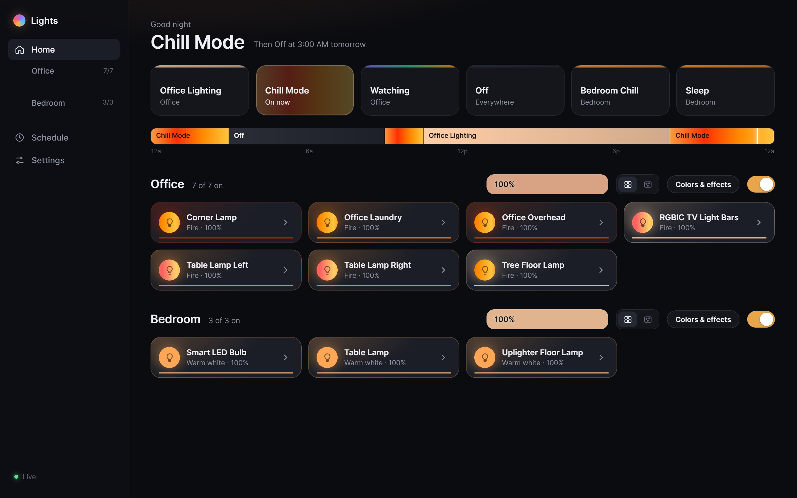
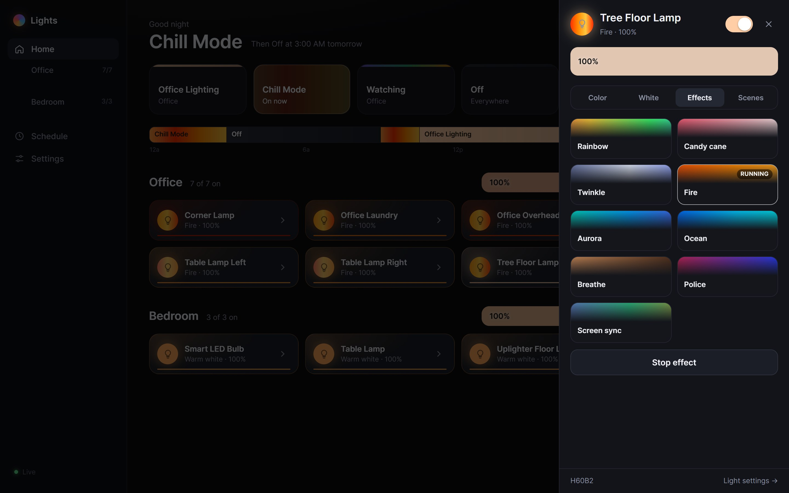
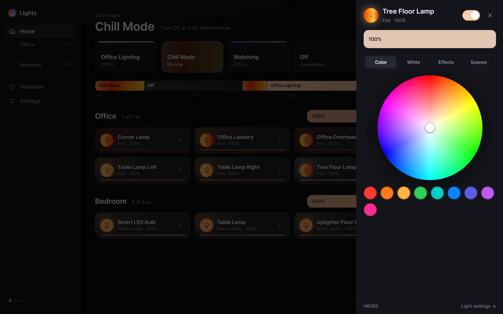
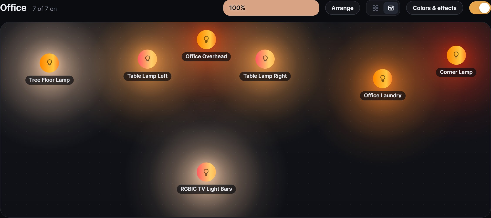
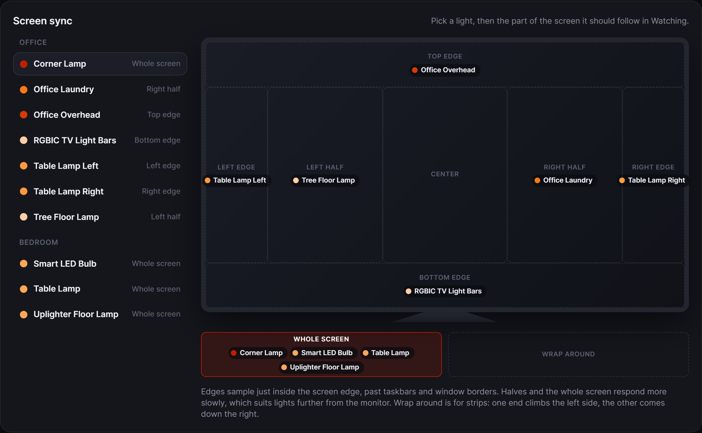
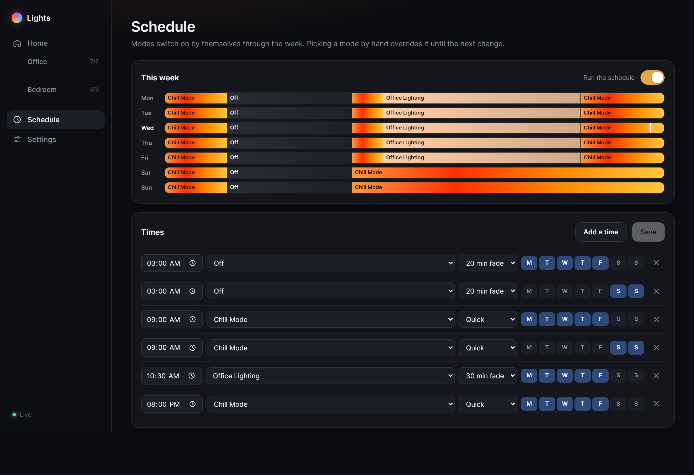
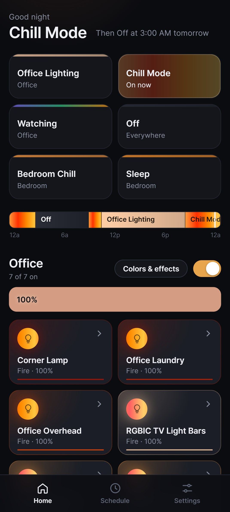
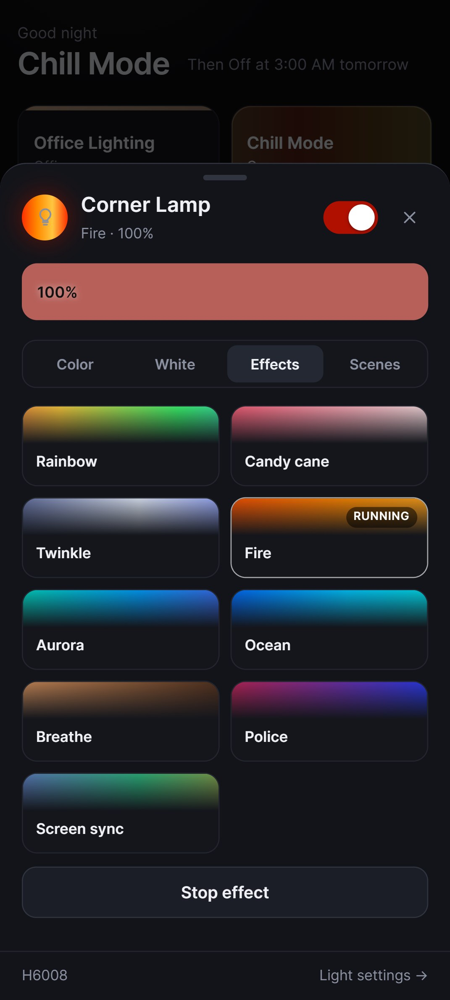

<h1 align="center">open-lights</h1>

<p align="center">
  <b>Local, fast, good-looking control for Govee lights.</b><br>
  One Python file you run on a Raspberry Pi or any computer. No dependencies, no account, no cloud round-trips.
</p>

<p align="center">
  
</p>

---

## Why

The Govee app is slow, cloud-bound and fiddly. Most Govee lights can also be controlled over your own network, and open-lights uses that:

- Commands land in about 50 ms.
- Effects stream at 50 fps.
- Everything keeps working with the internet down.

On top of that it adds what the app never had: modes, a real schedule, slow fades, screen sync and a page that updates live on every device.

## Features

|  |  |
| --- | --- |
| **Modes** | Save any setup ("Office Lighting", "Chill", "Watching", "Sleep") and switch with one tap, a schedule or a Stream Deck button. |
| **Weekly schedule** | Modes change by themselves through the week. A hand-picked mode overrides until the next scheduled change. |
| **Slow fades** | Ease into work light over 30 minutes, or dim to off over 20 at night. Touch a light mid-fade and you take over. |
| **Effects** | Fire, Aurora, Ocean, Twinkle and more, streamed to segmented lights at 50 fps. Lights you'd rather keep on Govee's own animations get the matching built-in scene. |
| **Screen sync** | Lights follow your monitor while you watch. Each light samples its own part of the screen. Colours come from the dominant hue rather than a muddy average, and blacks stay black. |
| **Live everywhere** | The server pushes every change to every open page as it happens: a tap on your phone, a Stream Deck press, the schedule. |
| **Phone app** | The same page installs as an app (PWA). Remote access with Tailscale works out of the box. |
| **Premium feel** | Soft crossfades on every change, no white flashes, gentle effects by default. |
| **No dependencies** | Python 3 standard library only. The screen capture on Windows uses ctypes. |

## A look around

<table>
  <tr>
    <td width="50%"><br><sub><b>Controls panel.</b> Brightness, colour, white, effects and Govee scenes, for one light or a whole room.</sub></td>
    <td width="50%"><br><sub><b>Colour wheel and presets.</b> Drag for instant changes; presets crossfade.</sub></td>
  </tr>
  <tr>
    <td><br><sub><b>Room map (optional).</b> Lights sit where they are in the room and glow in their real colour. Tap to toggle, or drag them into place in Arrange mode.</sub></td>
    <td><br><sub><b>Screen sync setup.</b> Pick a light, then click the part of the monitor it should follow.</sub></td>
  </tr>
  <tr>
    <td colspan="2"><br><sub><b>Schedule.</b> The week at a glance, with a fade length for every change.</sub></td>
  </tr>
</table>

<p align="center">
  
  &nbsp;&nbsp;
  
</p>
<p align="center"><sub>On the phone: big mode buttons, room tiles, and a swipe-down controls sheet.</sub></p>

## Quick start

1. **Turn on LAN Control** in the Govee app for every light that offers it: open the light, then Settings, then *LAN Control*.
2. **Run the server** on any machine on the same network:

   ```sh
   git clone https://github.com/purzbeats/open-lights.git
   cd open-lights
   python3 server.py                  # http://127.0.0.1:8420
   python3 server.py --host 0.0.0.0   # reachable from other devices on your network
   ```

3. **Open the page, go to Settings and press *Scan for lights*.** Then name your lights and give them rooms.

**Optional: lights without LAN Control.** Get an API key in the Govee app (Profile → Settings → Apply for API Key). Put `GOVEE_API_KEY=...` in a `.env` next to `server.py` or in `~/.env`; see `.env.example`. Those lights then go through Govee's cloud, which is slower and has no fades or effects.

Your lights, rooms, modes, schedule and map live in `devices.json` and `modes.json`. Neither file is tracked by git.

## Running it on a Raspberry Pi

A Pi makes a good always-on home for it: it uses a fraction of one core, even while streaming screen sync.

```sh
git clone https://github.com/purzbeats/open-lights.git ~/open-lights
sudo cp ~/open-lights/deploy/open-lights.service /etc/systemd/system/   # edit User and paths first
sudo systemctl enable --now open-lights
journalctl -u open-lights -f                                            # logs
```

**On your phone, anywhere:** with [Tailscale](https://tailscale.com) on the Pi and your phone, run:

```sh
sudo tailscale serve --bg 8420
```

Then open `https://<pi>.<tailnet>.ts.net/m` and choose **Install** or **Add to Home Screen**.

## Screen sync (Watching)

The monitor being watched can be on another machine from the server. Screen capture is Windows only:

- **Server on the same Windows PC:** it samples the screen itself.
- **Server on a Pi or anywhere else:** run the small screen agent on the PC. It idles until a light is screen-syncing, then streams a 64×36 grid at 30 fps:

  ```sh
  pythonw screen_agent.py --server https://<pi>.<tailnet>.ts.net --log screen_agent.log
  ```

  To start it at login, add it to Task Scheduler with the trigger "At log on".

Set each light's screen zone in **Settings → Screen sync**:

- **Edges** sample just inside the screen, past taskbars and window borders.
- **Halves and Whole screen** respond more slowly, for lights further from the monitor.
- **Wrap around** suits light strips.

## Stream Deck and automation

Plain GET requests, so a "Website" button (with "GET request in background" ticked) or any automation tool can call them:

| URL | Does |
| --- | --- |
| `/api/mode/cycle?modes=office,chill,off` | Steps through those modes |
| `/api/mode/toggle/watching` | Turns a mode on, or goes back to what was on before |
| `/api/mode/<id>` | Switches to a mode |
| `/api/mode/resume` | Ends an override and goes back to the schedule |

For anything else, `POST /api/devices/<id | room:Name | all>` takes actions like `{"action":"color","r":255,"g":80,"b":0,"fade":1}`. The live state stream is at `GET /api/events`.

## How it's built

| File | What it is |
| --- | --- |
| `server.py` | HTTP server, LAN and cloud control, software fader, 50 fps effects engine, live event stream |
| `effects.py` | Effects and their matching Govee scenes (reloads live while the server runs) |
| `modes.py` | Modes, the weekly schedule, overrides and fades |
| `sync.py` | Turns screen frames into per-light, per-segment colours |
| `screen.py` | Windows screen sampler (ctypes GDI) |
| `screen_agent.py` | Streams screen frames from a PC to a remote server |
| `index.html`, `static/` | The app: one responsive page for desktop and phone, plus PWA files |

### Govee LAN protocol notes

These were learned the hard way:

- **Discovery** is a multicast `scan` to `239.255.255.250:4001`. Lights listen on `4003` and reply to `4002`. VPN interfaces such as Tailscale can swallow the multicast, so discovery binds to the LAN interface; set `GOVEE_IFACE=192.168.x.y` to force one.
- **A light ignores `colorwc` when the value equals its stored one.** If a Govee scene is running, it stays in that scene. The fix is to send a slightly different value first.
- **Streaming ("razer"/DreamView):** frames are `BB 00 len B0 grad n rgb… xor`, base64-encoded.
  - The H60B2 needs exactly 3 segments.
  - Re-sending the enable packet mid-stream blanks a frame.
  - About 50 fps looks smoothest.
- **Leaving a stream without a flash:** fade the frames into the target colour, send `colorwc` while still streaming, then turn streaming off.
- **The H6046 stops answering `devStatus` while streaming.**

**Tested with:** H60B2 (floor lamp), H6046 (TV light bars), H6022 (table lamps), H6008 (bulbs) and H60B0 (uplighter floor lamp). Other LAN-capable Govee lights should work for power, brightness and colour.

## Changelog

See [CHANGELOG.md](CHANGELOG.md).

## License

MIT. Not affiliated with Govee.
